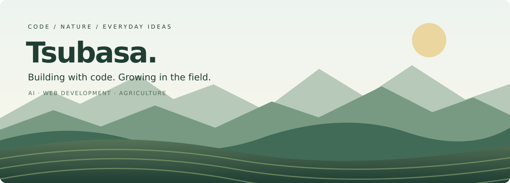

  

# Hi, I'm Tsubasa 🌱

**コードを書いて、畑を耕す。身近なアイデアを、使える形に。**

AI・Webアプリ開発に取り組むソフトウェアエンジニアです。  
農業や日々の暮らしで感じた課題をきっかけに、小さなツールやサービスを作っています。

### 🏔️ What I do

- **AI & Automation** — AIエージェント、RAG、日々の作業の自動化
- **Web Development** — Laravel・Python・Reactを使ったアプリ開発
- **Agriculture & Tech** — 作業記録や在庫管理など、農業の現場で役立つ仕組みづくり

### 🧰 Toolbox

| Area | Technologies |
| :--- | :--- |
| Languages | PHP / Python / JavaScript |
| Web | Laravel / React / Tailwind CSS |
| Infrastructure | AWS / Cloudflare Workers / Docker |
| Data | MySQL / Cloudflare D1 |

### 🎧 Recently played

作業中も、ひと息つくときも、音楽と一緒に。

### 🌾 Beyond the screen

畑に出たり、MTBで山を走ったり、釣りに出かけたり。  
画面の外で見つけた気づきも、ものづくりにつなげていきたい。

---

Keep building. Keep growing.
